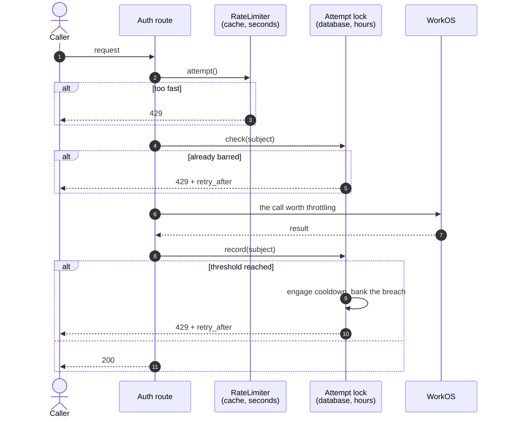

# Attempt Locks

A reusable primitive for bounding how often the same caller can repeat an action that costs something — a delivered message, a billed SMS, a record created upstream, or a guess at a short secret.

It is written for two audiences in parallel: a developer wiring a lock into a new flow, and an LLM agent reading it as the source of truth for code-gen. The patterns and gotchas below are exhaustive — if your integration deviates from them, you are almost certainly hitting one of the **Don't do this** sections at the bottom.

> **Plugin requirement:** integration-workos **1.0.9** or later.

---

## At a glance

| Lock | Slug | Counts | Default allowance | Applied in |
| --- | --- | --- | --- | --- |
| One-time code delivery | `otp_send` | Requests that may send a code | 5 per address | `/auth/magic/send`, `/auth/password/authenticate` (verification refusals), `/auth/signup/create` |
| Password sign-in | `password_auth` | Failures only | 10 per account | `/auth/password/authenticate`, `admin-ajax.php` headless login, the `authenticate` filter |
| Password reset delivery | `password_reset` | Requests that send a link | 5 per account | `/auth/password/reset/start`, `/admin/users/{id}/password-reset` |
| Multi-factor challenge | `mfa_challenge` | Challenges issued | 5 per factor | `/auth/mfa/challenge` |
| Account creation | `signup` | Create attempts | 3 per address | `/auth/signup/create` |
| Code and token redemption | `token_guess` | Failures only | 10 per token | reset confirm, signup verify, magic verify, MFA verify, invitation accept, email-change confirm/cancel |

Every lock returns the same refusal as the burst limiter — `WP_Error( 'workos_rate_limited', …, [ 'status' => 429, 'retry_after' => N, 'lock' => $slug ] )` — so clients and the login UI need no special handling for the two.

---

## Why this exists

The plugin already had throttling: `WorkOS\Auth\AuthKit\RateLimiter`, a fixed-window limiter wired into every public auth route. It is cheap, it runs first, and it stays. But it is **advisory by construction**, for three reasons its own docblock spells out:

1. **Its storage is cache, not record.** Counters live in transients and an object-cache group. A flush, an eviction, or a restart of a non-persistent object cache empties them, and the full allowance comes back.
2. **Its fallback path is not atomic.** Without a persistent object cache it does a read-modify-write that concurrent requests interleave, so parallel requests can each read the same count and each write the same increment.
3. **A fixed window has edges.** A window opening at `t` permits a full allowance at `t+59s` and another at `t+61s`.

None of that matters much for smoothing a burst, which is the limiter's job. It matters a great deal when the thing being repeated costs money or weakens a secret. So there are two layers now, with different jobs:

|  | `RateLimiter` | Attempt lock |
| --- | --- | --- |
| Question | "too fast right now?" | "has this been repeated?" |
| Storage | transients / object cache | user meta / options |
| Horizon | seconds | hours |
| Survives a cache flush | no | yes |
| On repeat | identical window | escalating cooldown |
| Cost per call | cache read | database read |

They compose. The limiter rejects a flood before the lock is consulted at all; the lock catches what a flood-shaped limiter cannot see.

---

## The calling convention

Three steps, and the order matters.

```php
$lock    = workos()->lock( 'otp_send' );   // or $this->lock( 'otp_send' ) in a BaseEndpoint
$subject = $lock->for_email( $email );

// 1. Gate. Reads only — a barred caller costs one read and nothing else.
$gate = $lock->check( $subject );
if ( is_wp_error( $gate ) ) {
    return $gate;
}

// 2. The work worth throttling.
$result = workos()->api()->send_magic_auth_code( $email );

// 3. Count it.
$lock->record( $subject );
```

`check()` never writes. `record()` returns `true` while the subject is under threshold and a 429 on the attempt that engages the lock, so it is worth returning:

```php
$recorded = $lock->record( $subject );
if ( is_wp_error( $recorded ) ) {
    return $recorded;   // tells the caller they have just used their last attempt
}
```

### Counting failures instead of attempts

For anything where success is the normal case — a password, a code, a token — count the failure and clear on success:

```php
$gate = $lock->check( $subject );
if ( is_wp_error( $gate ) ) {
    return $gate;
}

$result = attempt_the_thing();

if ( is_wp_error( $result ) ) {
    $lock->record( $subject );
    return $result;
}

$lock->release( $subject );   // correct answer wipes the slate
```

Without the `release()`, someone who mistypes their own password twice each morning is gradually locked out of an account they own.

### Inside a REST endpoint

`BaseEndpoint` provides thin wrappers that take several subjects at once:

```php
$lock     = $this->lock( 'otp_send' );
$subjects = null !== $lock ? [ $lock->for_email( $email ), $lock->for_ip( $ip ) ] : [];

$gate = $this->lock_check( 'otp_send', $subjects );
if ( is_wp_error( $gate ) ) {
    return $gate;
}

// … the expensive call …

$recorded = $this->lock_record( 'otp_send', $subjects );
if ( is_wp_error( $recorded ) ) {
    return $recorded;
}
```

List the most specific subject first: `lock_check()` returns the first refusal it finds, and the caller sees that lock's message.

`lock_record()` deliberately counts **every** subject even after one has tripped — stopping at the first would leave the others undercounted.

---

## How the ladder works



Two counters, and the distinction between them is the whole design:

- **`strikes`** — attempts in the current run. Reset whenever a cooldown engages, and whenever the subject goes quiet long enough to decay.
- **`breaches`** — how many times this subject has already been locked. **Survives the cooldown**, which is what makes the ladder escalate. Without it, a caller could sit at the threshold indefinitely and pay the same small cooldown every round.

Default ladder, one rung per prior breach, holding at the last: **5 min → 15 min → 1 h → 6 h → 24 h**.

**Decay** (default 24 h of quiet) clears `strikes` *and* `breaches`, so an ordinary person who once fumbled a form is not carrying a penalty a week later. It is measured from the moment the cooldown **ends**, not from when it began — otherwise a decay window shorter than the cooldown preceding it would forgive a subject while the lock was still holding.

---

## Subjects and storage

A lock never counts "requests" in the abstract; it counts requests by a **subject**.

| Built with | Kind | Stored in |
| --- | --- | --- |
| `for_user( 42 )` | `user` | user meta, `_workos_lock_{slug}` |
| `for_email( $addr )`, address owned by a WP user | `email` | user meta, `_workos_lock_{slug}` |
| `for_email( $addr )`, no WP user | `email` | option, `workos_lock_{slug}_{sha256(identity)}` |
| `for_ip( $addr )` | `ip` | option |
| `for_key( $value )` | `key` | option |

**The option fallback is the ordinary case, not an edge case.** Accounts are created in WorkOS first and only mirrored into WordPress on a *successful* login, so a great deal of real traffic references an address with no local user behind it. A user-meta-only design would not see it at all.

Subject values are SHA-256 hashed into storage keys, so no address ever sits in `wp_options` in plaintext. Option rows are written with autoload off and carry an `expires_at` stamp; a daily `workos_lock_gc` sweep prunes expired rows and enforces a ceiling on the total (default 50 000) so a caller cycling through throwaway addresses cannot grow the table without bound.

When an address that already has counters gains a WordPress user, the record is **moved onto that user** on the next read. Counting stays continuous across account creation, and there is no orphaned row left behind to report a lock that no longer applies.

### IP subjects are deliberately weak

Behind a CDN, a corporate NAT, or a university, one address fronts an entire audience. A durable escalating lock on that address would lock all of them out together — worse than the behaviour being bounded. So IP subjects get a **4× threshold** and a **15-minute cooldown ceiling**, and the per-identity locks carry the real teeth.

If your site is behind a proxy, tell the plugin which header carries the real client address:

```php
add_filter( 'workos_trusted_proxy_header', fn() => 'HTTP_CF_CONNECTING_IP' );
```

Or set the `trusted_proxy_header` option. It is empty by default — a forwarding header is caller-supplied unless something in front of the site overwrites it on every inbound request, and trusting one that isn't overwritten lets a caller mint a fresh identity per request.

---

## Writing a new lock

Subclass `BaseLock`, supply a slug and a policy. That is the whole exercise:

```php
namespace Acme\Locks;

use WorkOS\Lock\BaseLock;

class InviteResendLock extends BaseLock {

    public function slug(): string {
        return 'invite_resend';
    }

    public function label(): string {
        return __( 'Invitation resend', 'acme' );
    }

    protected function default_threshold(): int {
        return 3;
    }

    protected function default_cooldowns(): array {
        return [ 10 * MINUTE_IN_SECONDS, HOUR_IN_SECONDS, DAY_IN_SECONDS ];
    }

    protected function message(): string {
        return __( 'That invitation has been resent several times already.', 'acme' );
    }
}
```

Register it:

```php
add_filter( 'workos_locks', function ( array $locks, $store ) {
    $locks['invite_resend'] = new \Acme\Locks\InviteResendLock( $store );
    return $locks;
}, 10, 2 );
```

It now appears in `wp workos lock list`, in the user-edit panel, and in the operator clear — no further wiring.

---

## Filters and actions

| Hook | Type | Arguments | Purpose |
| --- | --- | --- | --- |
| `workos_locks_enabled` | filter | `$enabled` | Master switch. False leaves the burst limiter in place. |
| `workos_locks` | filter | `$locks`, `$store` | Register or replace locks. |
| `workos_lock_enabled` | filter | `$enabled`, `$subject`, `$slug` | Disable one lock. |
| `workos_lock_threshold` | filter | `$threshold`, `$subject`, `$slug` | Attempts before a cooldown. |
| `workos_lock_cooldowns` | filter | `$ladder`, `$subject`, `$slug` | The ladder, in seconds. |
| `workos_lock_decay` | filter | `$seconds`, `$subject`, `$slug` | Quiet period before forgiveness. |
| `workos_lock_subject` | filter | `$subject`, `$slug` | Rewrite a subject before it is counted. |
| `workos_lock_store` | filter | `$store`, `$subject` | Override the chosen backend. |
| `workos_lock_state` | filter | `$state`, `$subject`, `$slug` | Inspect or adjust loaded state. |
| `workos_lock_current_time` | filter | `$timestamp` | The clock every lock reads. Primarily for tests. |
| `workos_lock_row_ceiling` | filter | `$ceiling` | Maximum option rows retained. |
| `workos_trusted_proxy_header` | filter | `$header` | Header carrying the real client IP. |
| `workos_lock_engaged` | action | `$slug`, `$subject`, `$state` | Fired when a cooldown engages. |
| `workos_lock_released` | action | `$slug`, `$subject`, `$state` | Fired when a lock is cleared. |

Each filter also has a per-lock variant with the slug appended: `workos_lock_threshold_otp_send`, `workos_lock_cooldowns_signup`, and so on.

```php
// Triple the code-delivery allowance on a high-volume site.
add_filter( 'workos_lock_threshold_otp_send', fn( $threshold ) => $threshold * 3 );

// Turn locks off in staging, keeping the burst limiter.
add_filter( 'workos_locks_enabled', fn( $on ) => 'staging' !== wp_get_environment_type() );
```

---

## Operator surfaces

**Users list** — a "Clear login locks" action appears under the WorkOS column, but only for users who actually hold a lock, so it doubles as the signal that one engaged.

**User-edit screen** — a panel listing each engaged lock with its attempt count and remaining cooldown, and a button to clear them.

Both are plain nonced links to `admin-post.php`, gated on **`edit_users`**. There is no REST route and no script: the capability and nonce checks are WordPress's own, nothing new is exposed, and it works with JavaScript off.

**WP-CLI:**

```bash
wp workos lock list
wp workos lock status otp_send someone@example.com
wp workos lock clear otp_send someone@example.com
wp workos lock clear-user 42
wp workos lock gc
```

**Activity log** — `lock.engaged`, `lock.released` and `lock.cleared` events, filterable on the Activity Log screen. Subjects are recorded as a kind plus a truncated hash, so the log does not become a second copy of everyone's address.

---

## Don't do this

**Don't use a lock instead of the burst limiter.** They answer different questions. Dropping `rate_limit()` in favour of a lock means every flood request now costs a database read before it is refused.

**Don't `record()` before the expensive call.** The counter is meant to reflect work that happened. Counting first also double-charges callers whose request fails for an unrelated reason, like a malformed payload.

**Don't forget `release()` on a failure-counting lock.** Without it the lock counts lifetime failures rather than consecutive ones, and eventually bars people from accounts they own.

**Don't count an attempt that did not cost anything.** A refused sign-in sends no message, so it must not consume the code-delivery allowance — otherwise mistyping a password produces a message about codes that were never sent. `Password::triggered_verification_email()` is the shape to copy: work out from the refusal whether the side effect actually occurred.

**Don't make the count depend on whether an account exists.** Where a route answers uniformly to avoid confirming that an address is registered, count the attempt whether or not the underlying send happened. Counting only real sends makes the lock engage sooner for addresses that have accounts, which reintroduces exactly the difference the uniform response exists to remove.

**Don't put an escalating IP lock in front of a CDN without `trusted_proxy_header`.** `REMOTE_ADDR` is the edge node there, and every visitor shares one bucket.

**Don't reach into the meta key or option row directly.** Go through the lock: `status()` applies decay on read, and the storage backend can move a record between user meta and options as an address gains a user.

**Don't gate the operator unlock on `edit_user( $id )`.** That capability passes for anyone editing their own profile, which would let a locked-out user lift their own lock. Use `edit_users`.

**Don't expose lock state or an unlock action through a new REST or AJAX endpoint.** The admin surface is server-rendered on purpose; adding an endpoint gives back the attack surface this design avoids.

---

## Related

- [`docs/password-reset.md`](password-reset.md) — the reset flows these locks guard.
- [`docs/change-email.md`](change-email.md) — the confirm and cancel routes covered by `token_guess`.
- `src/WorkOS/Auth/AuthKit/RateLimiter.php` — the burst limiter that runs first.
