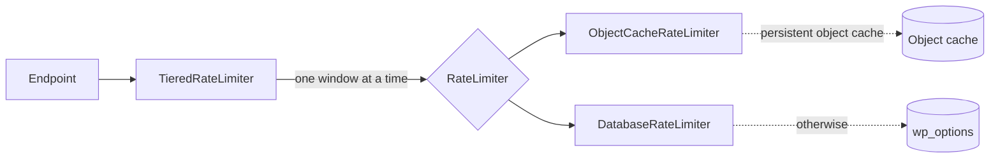

# Rate Limiting

This document covers how `integration-workos` throttles its public endpoints, how the limits are shaped, and which rules apply where.

It is written for two audiences in parallel: a developer adding or changing an endpoint, and an LLM agent reading it as the source of truth for code-gen. If you are adding a route that can cause an email to be sent, read [Adding a send path](#adding-a-send-path) before writing it.

> **Plugin requirement:** unreleased as of 1.0.8. Earlier versions shipped a single per-endpoint limiter with one 60-second window and no per-recipient limit.

---

## At a glance

Two questions get asked on every mutation, and they are not the same question:

- **Is this caller asking too fast?** Bounded per operation, on a single 60-second window.
- **Has this mailbox received enough?** Bounded across every path that can send, on layered windows.

A requester limit cannot answer the second one. Several operations can each mail the same address under their own separate allowance, and a per-minute window with nothing behind it makes that rate sustainable forever. So sends carry a second, longer-horizon limit keyed on the recipient.

Everything lives in `src/WorkOS/RateLimit/`:

| Class | Responsibility |
|---|---|
| `RateLimiter` | Interface. One bucket, one subject, one limit, one window. |
| `BaseRateLimiter` | Window arithmetic, key derivation, the `429` shape. |
| `DatabaseRateLimiter` | Counters in transients. |
| `ObjectCacheRateLimiter` | Counters in the object cache, incremented atomically. |
| `TieredRateLimiter` | Stacks windows into a policy. Owns the policy constants, the policy filter and the `workos_rate_limited` action. |
| `CountsAttempts` | Optional interface: read a counter without charging it. Both implementations provide it. |
| `Lockouts` | Looks up and clears the email-keyed buckets for one address. |
| `Controller` | Binds the implementation, the wrapper and `Lockouts`. |

Client IP resolution lives outside this module, in `WorkOS\Http\ClientIp`, because the activity log and the audit log need the same answer. See [Who the caller is](#who-the-caller-is).



Endpoints depend on `TieredRateLimiter`. It knows about policies; the limiter under it only counts. `RateLimit\Controller` picks the implementation once at boot based on `wp_using_ext_object_cache()`, and is registered ahead of the features that consume it.

## Policies

A policy is a list of `[ limit, window_seconds ]` tiers. One tier behaves exactly like a plain per-minute limit; several tiers stack.

| Constant | Tiers | Used for |
|---|---|---|
| `REQUEST_IP` | 10 / min | Per-IP request throttle |
| `REQUEST_SUBJECT` | 5 / min | Per-email, per-user, or per-factor request throttle |
| `SEND_RECIPIENT` | 3 per 5 min, 5 per hour, 10 per 8 hours | Who receives the mail |
| `SEND_IP` | 10 per 5 min, 30 per hour, 100 per 8 hours | Who triggered the send |

Why the send policies layer: a single fixed window is burstable across its boundary by construction. Spend the maximum, wait for the rollover, spend it again. The short tier keeps a mistyped address usable within a few minutes; the hour and 8-hour tiers are the actual ceiling.

Why the request policies do not: a daily cap on sign-in attempts locks out legitimate users who mistype a password, and the abuse it would prevent is already covered by the send limits. Adding tiers there is a one-line edit if that changes.

Two endpoints declare their own request policy instead of using the shared ones, each next to the endpoint that owns the reasoning:

| Constant | Tiers | Why |
|---|---|---|
| `Signup::RATE_LIMIT_CREATE_IP` / `_CREATE_EMAIL` | 5 / min, 3 / min | Tighter: signup creates an account for an address nobody has proven they own. |
| `Signup::RATE_LIMIT_VERIFY_IP` | 10 / min | Verify is cheap and users retype codes. |
| `OAuth::RATE_LIMIT_URL_IP` | 20 / min | Looser: building an authorize URL sends nothing and costs no WorkOS call. |

These are class constants, not settings, and there is no admin UI for them. The defaults are a support contract, and the earlier per-feature options (`change_email_rate_limit_*`, removed) were four knobs nobody tuned, where a stored `0` silently meant "unlimited". A site that really needs different numbers, such as one behind a proxy that collapses visitors or a support desk that signs in on behalf of customers, uses the filter below instead.

## Buckets

Every limit is charged against a named bucket. These are the names the filter, the action and the activity log use.

| Bucket | Subject | Default |
|---|---|---|
| `password_ip` | IP | `REQUEST_IP` |
| `password_email` | email, exact | `REQUEST_SUBJECT` |
| `password_otp_ip` | IP | `SEND_IP` |
| `password_otp_recipient` | mailbox | `SEND_RECIPIENT` |
| `pw_reset_ip` | IP | `REQUEST_IP` |
| `pw_reset_email` | mailbox | `REQUEST_SUBJECT` |
| `pw_reset_confirm_ip` | IP | `REQUEST_IP` |
| `magic_send_ip` | IP | `REQUEST_IP` |
| `magic_send_email` | mailbox | `REQUEST_SUBJECT` |
| `magic_verify_ip` | IP | `REQUEST_IP` |
| `magic_verify_email` | email, exact | `REQUEST_SUBJECT` |
| `otp_send_ip` | IP | `SEND_IP` |
| `otp_send_recipient` | mailbox | `SEND_RECIPIENT` |
| `email_verify_ip` | IP | `REQUEST_IP` |
| `email_verify_token` | pending token | `REQUEST_SUBJECT` |
| `email_verify_resend_ip` | IP | `REQUEST_IP` |
| `signup_ip` | IP | 5 / min |
| `signup_email` | mailbox | 3 / min |
| `signup_verify_ip` | IP | 10 / min |
| `mfa_challenge_ip` | IP | `REQUEST_IP` |
| `mfa_challenge_factor` | factor ID | `REQUEST_SUBJECT` |
| `mfa_verify_ip` | IP | `REQUEST_IP` |
| `invitation_lookup_ip` | IP | `REQUEST_IP` |
| `invitation_accept_ip` | IP | `REQUEST_IP` |
| `oauth_url_ip` | IP | 20 / min |
| `change_email_init_ip` | IP | `SEND_IP` |
| `change_email_init_recipient` | user ID | `SEND_RECIPIENT` |
| `pw_reset_admin_ip` | IP | `REQUEST_IP` |
| `pw_reset_admin_user` | user ID | `REQUEST_SUBJECT` |

"Exact" and "mailbox" are explained under [Which mailbox](#which-mailbox).

### Tuning a bucket

`workos_rate_limit_policy` filters the tiers one bucket runs with. It receives the default policy and the bucket name, and returns a list of `[ limit, window_seconds ]` tiers:

```php
add_filter(
	'workos_rate_limit_policy',
	static function ( array $policy, string $bucket ): array {
		// A support desk signing in from one office IP.
		if ( 'password_ip' === $bucket ) {
			return [ [ 60, MINUTE_IN_SECONDS ] ];
		}

		return $policy;
	},
	10,
	2
);
```

- The filter runs on every attempt, refund and reset, so all three see the same tiers.
- A return value that is not an array is ignored and the default applies.
- An empty array turns the bucket off. Tiers with a non-positive limit or window are dropped one at a time, as with the constants.
- Loosening a send bucket (`*_recipient`, `otp_send_ip`, `password_otp_ip`, `change_email_init_ip`) raises how much mail one inbox or one caller can cause. Prefer loosening the request bucket that is actually in the way.

### When a limit triggers

A refused attempt fires one action, from the first tier that refused:

```php
do_action( 'workos_rate_limited', string $bucket, string $subject_hash, int $retry_after );
```

`$subject_hash` is `TieredRateLimiter::hash_subject( $subject )`: the first 16 hex characters of an HMAC-SHA256 under `wp_salt( 'auth' )`. It is stable on one site, so repeated entries for the same address or IP line up, and it can't be checked against a guessed address without the salt. The raw subject is never passed to the hook.

When the activity log is enabled, the plugin hooks this action and writes one `rate_limited` entry with the bucket, the subject hash and `retry_after` in its details. The entry's user and IP columns stay empty on purpose: for a per-IP or per-email bucket they would hold the subject the hash is hiding. The activity log screen can filter on `rate_limited`.

## Looking up and clearing lockouts

When a customer is locked out, support can see which limits are blocking an address and clear them, from WP-CLI or the WorkOS Users screen. Both go through `WorkOS\RateLimit\Lockouts`.

Only the buckets keyed on an email address are covered: `password_email`, `magic_verify_email`, `magic_send_email`, `pw_reset_email`, `signup_email`, `otp_send_recipient` and `password_otp_recipient`. Per-IP buckets aren't tied to a customer, and the user-ID buckets guard admin and account actions, not sign-in.

Each bucket is keyed the way its endpoint keys it, so the address a customer typed finds the counters their requests hit: lowercased and trimmed for the exact buckets, reduced to the mailbox for the rest (see [Which mailbox](#which-mailbox)). Limits come from the filtered policy.

```sh
# One row per window: count, limit, time left, locked.
wp workos ratelimit check jane@example.com
wp workos ratelimit check jane@example.com --format=json

# Clear every bucket, or one.
wp workos ratelimit clear jane@example.com
wp workos ratelimit clear jane@example.com --bucket=password_email --user=admin
```

A bucket is locked while any of its windows is full, and stays locked until the last full window rolls. Clearing resets the current window of every tier, so the next request goes through.

On **WorkOS → Users**, a "Sign-in lockouts" section below the user list takes an email and shows the same buckets, with a Clear button per bucket and a Clear all. It is shown to users with `edit_users`, and calls two routes gated by the same capability:

| Route | Body | Returns |
|---|---|---|
| `POST /wp-json/workos/v1/admin/lockouts/check` | `email` | `buckets` (as `Lockouts::check()`), `locked` count |
| `POST /wp-json/workos/v1/admin/lockouts/clear` | `email`, optional `bucket` | `cleared` bucket names |

Both are POST so the address stays out of URLs and access logs.

Every clear writes one `rate_limit_cleared` activity-log entry. The user column is whoever cleared it (on the CLI, the `--user` the command ran as), and the details hold `source` (`cli` or `admin`) and each cleared bucket with its subject hash, which matches the `subject_hash` of that bucket's `rate_limited` entries. The address itself is never stored.

## Where limits apply

Every public auth route is throttled by requester. A subset also counts as a send.

| Endpoint | Request subject | Request policy | Send policy |
|---|---|---|---|
| `POST /auth/password/authenticate` | email, exact | shared | yes, reserved — see [Reserve and refund](#reserve-and-refund) |
| `POST /auth/password/reset/start` | mailbox | shared | yes (`otp_send`) |
| `POST /auth/password/reset/confirm` | — | shared (IP only) | no |
| `POST /auth/magic/send` | mailbox | shared | yes (`otp_send`) |
| `POST /auth/magic/verify` | email, exact | shared | no |
| `POST /auth/email-verification/verify` | pending token | shared | no |
| `POST /auth/email-verification/resend` | — | shared (IP only) | yes (`password_otp`) |
| `POST /auth/signup/create` | mailbox | `Signup` constants | no — see below |
| `POST /auth/signup/verify` | — | `Signup` constants (IP only) | no |
| `POST /auth/mfa/challenge` | factor ID | shared | no |
| `POST /auth/mfa/verify` | — | shared (IP only) | no |
| `GET /auth/invitation/{token}` | — | shared (IP only) | no |
| `POST /auth/invitation/accept` | — | shared (IP only) | no |
| `GET /auth/oauth/authorize-url` | — | `OAuth` constant | no |
| `POST /users/{id}/email-change` | user ID | — | yes |
| `POST /admin/users/{id}/password-reset` | user ID | shared | no |

"Shared" means `REQUEST_IP` plus, where there is a subject, `REQUEST_SUBJECT`. "Exact" and "mailbox" are the two email keyings described under [Which mailbox](#which-mailbox).

`magic_send` and `pw_reset` share the `otp_send` bucket prefix, so rotating between those two endpoints buys an attacker nothing. `password` uses its own `password_otp` prefix: it reserves before it knows whether a send happens, and sharing would let heavy magic-code use lock an account out of password sign-in. The email-verification resend charges the same `password_otp` pair, so the code WorkOS mailed on the password attempt and its resends share one allowance.

Two routes deliberately have no send policy. `signup` sends one verification email per created account, and a duplicate `create_user` fails at WorkOS before the send is reached, so it is not repeatable per address. `pw_reset_admin` requires `edit_user` on the target and mails that account's own address, so the recipient is never caller-chosen.

Send buckets are charged **before** deciding whether the send actually fires. That keeps `429` behavior identical for existing and unknown accounts, so bucket state cannot be used to enumerate which addresses have accounts.

## Reserve and refund

Most send paths know they are about to send. `password/authenticate` does not.

WorkOS decides: authenticating an account whose email is unverified makes it mail a one-time verification code as a side effect, and it only tells us afterwards, via an `email_verification_required` error. By the time the response is in hand, the email has already gone out.

So that path claims the slot before the call and hands it back when the outcome shows nothing was sent:

```php
$mailbox  = $this->canonicalizer->canonical( $email );
$reserved = $this->rate_limit(
    [
        [ self::BUCKET_PASSWORD_OTP_IP, $ip, TieredRateLimiter::SEND_IP ],
        [ self::BUCKET_PASSWORD_OTP_RECIPIENT, $mailbox, TieredRateLimiter::SEND_RECIPIENT ],
    ]
);
if ( is_wp_error( $reserved ) ) {
    return $reserved;
}

$workos_response = workos()->api()->authenticate_with_password( /* … */ );

if ( ! $this->triggered_verification_email( $workos_response ) ) {
    $this->rate_limiter->refund( self::BUCKET_PASSWORD_OTP_IP, $ip, TieredRateLimiter::SEND_IP );
    $this->rate_limiter->refund( self::BUCKET_PASSWORD_OTP_RECIPIENT, $mailbox, TieredRateLimiter::SEND_RECIPIENT );
}
```

Counting afterwards instead would leave a gap the width of the HTTPS round trip, and every concurrent request arriving inside it would read the same number and pass. Refunding means wrong passwords and completed logins cost a recipient nothing, so the bucket only accumulates on outcomes that actually mailed.

One imprecision is deliberate: if an operator disables WorkOS-side verification emails, `email_verification_required` still charges a slot even though nothing was mailed. That setting is not visible from here, and charging is the safe direction.

## How counting works

A counter is identified by a **bucket** naming the operation and a **subject** naming what is limited. Subjects are hashed into the key, so no address or IP is stored in plaintext.

The window is part of the key: `floor( now / window )`. A new window is simply a different key, which means expiry is the storage TTL and `retry_after` is arithmetic, with no stored start time and no reset bookkeeping.

One consequence worth knowing: windows are aligned to the clock rather than starting at a caller's first attempt. A caller arriving at `:59` gets a fresh window one second later.

Tiers are charged shortest window first, and the first exhausted tier returns immediately. A burst stopped by the short tier therefore never inflates the longer ones. A refused attempt still counts against the tier that refused it, so hammering keeps that window pinned until it rolls.

### Who the caller is

Every per-IP bucket is only as good as the address behind it, so resolution has one owner: `WorkOS\Http\ClientIp`, shared by rate limiting, the activity log, and the audit log.

By default that is `REMOTE_ADDR` and nothing else. The webserver sets it and a caller cannot forge it.

Behind a CDN, `REMOTE_ADDR` is the edge, so every visitor collapses into one bucket and the proxy's own header carries the real client. That header is authoritative only if the request actually arrived through the proxy: if the origin is reachable directly, the header is caller-supplied, and trusting it is worse than ignoring it, because anyone can mint a fresh bucket per request by changing a string. So it is never auto-detected. An operator names it, asserting that the origin only accepts proxied traffic:

```php
define( 'WORKOS_CLIENT_IP_HEADER', 'CF-Connecting-IP' );
```

A real environment variable of the same name works too. When the header holds a list, the **right-most public** entry wins: `X-Forwarded-For` appends on each hop, so entries to the right were written by infrastructure and everything to the left is whatever the client sent. Private and reserved entries are skipped while walking leftwards, and an entirely private list (a local proxy in development) falls back to the right-most valid entry.

When nothing usable is found, resolution returns `0.0.0.0` so a bucket still has a stable subject.

### Which mailbox

A per-recipient limit is only as good as the key it counts against. `alice@gmail.com`, `alice+1@gmail.com`, and `a.l.i.c.e@gmail.com` are three strings and one inbox, so email subjects are reduced to a mailbox by `WorkOS\Email\AddressCanonicalizer` before they become a bucket key. The canonical form is a key only; the address passed to WorkOS is always what the caller typed.

Both rewrites are opt-in per provider, and the reason is the asymmetry of guessing wrong:

- Collapsing two real mailboxes into one bucket lets either exhaust the other's allowance. On a corporate or self-hosted domain `business+brian@corp.com` is routinely its own mailbox with its own owner, so a blanket rule turns a spam control into a way to lock a colleague out.
- Splitting one real mailbox across several buckets lets a caller earn an allowance per tag, but the per-IP send limits still cap the total mail one caller can cause.

The second is recoverable; the first denies service to someone who did nothing wrong. So `+` is stripped only on domains known to treat it as a tag (Google, Outlook and its consumer domains, Fastmail), and dots are ignored only on Google. This is not over-caution: [RFC 5233](https://www.rfc-editor.org/rfc/rfc5233.html) states that the encoding of detailed addresses is "site and/or implementation specific", and RFC 5321 leaves local-part semantics to the destination host. Among big providers the convention is genuinely not universal, with Yahoo and iCloud offering disposable addresses instead of tags and Proton using a different separator.

#### Mailbox or account

Two different questions get keyed on an address, and they don't want the same answer:

- **Guessing limits** (`password_email`, `magic_verify_email`) bound attempts to guess a password or a code for one account. The right subject is the account, and WorkOS keys accounts on the exact address.
- **Mail-causing limits** (both `*_recipient` buckets, plus `magic_send_email`, `pw_reset_email`, and `signup_email`) bound how much mail an inbox receives. The right subject is the mailbox, so the canonical form is correct.

The split is not "request limits versus send limits". `pw_reset_email`, `magic_send_email`, and `signup_email` are per-request limits on routes whose whole effect is mail, so they belong with the mailbox group even though they sit next to the guessing limits in code.

The two groups therefore use different subjects, even where they sit side by side in the same `rate_limit()` call. Nothing stops someone registering `alice@gmail.com` and `alice+work@gmail.com` as separate accounts, since WorkOS treats them as distinct users, while Gmail delivers both to one inbox. Keying guessing on the exact address means an attacker hammering one cannot spend the other's sign-in budget; keying mail on the mailbox means they cannot double the volume aimed at that single inbox.

Guessing limits use the address as typed, which needs no account lookup, because the exact address is already the identifier WorkOS resolves. If you touch this, the neighbouring buckets look like the same kind of thing and are not: `signup_email` would let `alice+1@`, `alice+2@` and `alice+3@` create three accounts that all mail one inbox, and `pw_reset_email` and `magic_send_email` sit on routes that exist to send. All three stay canonical.

Conditioning on whether the address is already known to us was considered and rejected. It would cost a user lookup on every unauthenticated request, ahead of the limit that exists to avoid work; it would make the bucket key depend on whether an account exists; and pre-authentication we can only see WordPress users, so an account that exists only in WorkOS would key differently depending on sync state. Recognising an address as registered also says nothing about whether its inbox is shared, which is the only thing the send limit cares about.

The lists are fixed, not configurable. A self-hosted server that does treat `+` as a tag is invisible to us and will get a counter per tag, which is the milder of the two failures and is bounded by the per-IP send limits. Adding a domain is a code change, in `AddressCanonicalizer`.

### Storage

`ObjectCacheRateLimiter` is used when WordPress reports a persistent object cache. On a real backend `wp_cache_incr` is an atomic in-place increment, so two concurrent requests get distinct counts and a limit cannot be overspent.

`DatabaseRateLimiter` is the fallback. Incrementing is a read-modify-write, so a genuinely concurrent burst can overspend a window: several requests read the same count and all write the same value back. There is no fix at this layer without a lock. The longer tiers bound what that costs, and WorkOS's own back-end limits sit behind them.

To check which one a site is using:

```sh
wp eval 'var_dump( wp_using_ext_object_cache() );'
```

This is worth checking per environment rather than assuming. A site can ship an object-cache plugin and still run without one: Object Cache Pro is inert unless the `object-cache.php` drop-in is in place and `WP_REDIS_DISABLED` is not set. When it is inert, the transient path is what runs, and the concurrent-burst gap described above is open.

## Adding a send path

1. Take the slot before sending, with `SEND_IP` and `SEND_RECIPIENT`, keyed on the canonical mailbox rather than the address as typed.
2. Reuse `BaseEndpoint::BUCKET_OTP_SEND_IP` / `_RECIPIENT` unless the path has a reason not to share the allowance. Bucket names are constants so the sharing survives a rename.
3. Charge it before any "should we actually send?" branch, so a `429` never depends on whether the account exists.
4. If you only learn afterwards that nothing went out, refund both buckets.

## Don't do this

### Don't give a new send endpoint its own recipient bucket.

Four endpoints with four separate allowances against one inbox add up to four times the mail. Share `otp_send` so rotating between endpoints buys nothing.

### Don't check the limit and send later.

`attempt()` counts first for a reason. A read-only check followed by a send leaves a window in which concurrent callers all pass.

### Don't skip the charge when the send is conditional.

If the bucket is only charged on the branch that really sends, the `429` boundary differs between known and unknown addresses, and that difference is an account-enumeration oracle.

### Don't add a per-feature limit option.

That is what was removed. One policy, one place, applied to every path that mails a caller-chosen address. A site that needs other numbers uses `workos_rate_limit_policy`, which keeps the change in code next to the reason for it.

### Don't log or pass a raw subject.

Hooks and log entries carry `TieredRateLimiter::hash_subject()`, never the email or IP. A per-IP bucket's subject is the IP, so the `rate_limited` entry leaves the IP column empty too.

## Tests

| File | Covers |
|---|---|
| `tests/wpunit/RateLimiterTest.php` | The single-window contract, run against **both** implementations via a data provider, including `count()`. |
| `tests/wpunit/LockoutsTest.php` | Lookup keyed like the endpoints (exact and mailbox), filtered limits, clearing one or all buckets and every tier, the `rate_limit_cleared` entry. |
| `tests/wpunit/LockoutsRestApiTest.php` | The admin routes: `edit_users` required (signed out, subscriber, editor refused), check, clear, bad input. |
| `tests/wpunit/RateLimitCommandTest.php` | `wp workos ratelimit check` / `clear`, run against WP-CLI doubles in `tests/_support/WpCliStubs.php`. |
| `tests/wpunit/TieredRateLimiterTest.php` | Tier ordering and charging, against an in-memory fake limiter, plus a guard on the shipped policy constants; the policy filter (attempt, refund, reset, bad return values); the `workos_rate_limited` action and the subject hash. |
| `tests/wpunit/RateLimitActivityLogTest.php` | One `rate_limited` entry per refused attempt, with no raw email or IP in it; nothing written when the log is off. |
| `tests/wpunit/AuthKitRestPasswordTest.php` | Reserve/refund on authenticate; reset-start send caps; the shared bucket. |
| `tests/wpunit/AuthKitRestMagicSessionTest.php` | Magic-send caps and the shared bucket; the policy filter tightening a live route. |

`ObjectCacheRateLimiter` is only selected in production when a persistent cache exists, so the provider in `RateLimiterTest` is what exercises the atomic path in CI at all.

## Internal references

- `src/WorkOS/RateLimit/` — the module, including `Lockouts`.
- `src/WorkOS/CLI/RateLimitCommand.php` — `wp workos ratelimit`.
- `src/WorkOS/Admin/Users/LockoutsRestApi.php` and `src/js/admin-users/lockouts.tsx` — the lookup on the Users screen.
- `src/WorkOS/REST/Auth/BaseEndpoint.php` — the `rate_limit()` helper endpoints call.
- `src/WorkOS/Http/ClientIp.php` — caller identity, shared with the logs.
- `src/WorkOS/Email/AddressCanonicalizer.php` — which strings mean one mailbox.
- [`docs/change-email.md`](change-email.md) — the change-email flow's use of the send policy.
- [`docs/password-reset.md`](password-reset.md) — the reset endpoints.
